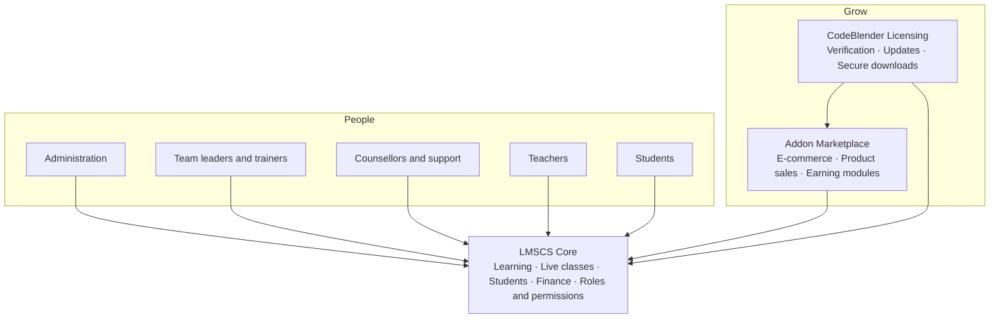

  
  
  
  

  <a href="#why-lmscs"><b>Why LMSCS</b></a> &nbsp;•&nbsp;
  <a href="#capabilities"><b>Capabilities</b></a> &nbsp;•&nbsp;
  <a href="#addon-marketplace"><b>Marketplace</b></a> &nbsp;•&nbsp;
  <a href="#roles"><b>Roles</b></a> &nbsp;•&nbsp;
  <a href="#security"><b>Security</b></a> &nbsp;•&nbsp;
  <a href="#architecture"><b>Architecture</b></a> &nbsp;•&nbsp;
  <a href="#contact"><b>Contact</b></a>

<table>
  <tr>
    <td align="center" width="25%"><h2>23</h2><b>READY-MADE ROLES</b></td>
    <td align="center" width="25%"><h2>60</h2><b>GRANULAR PERMISSIONS</b></td>
    <td align="center" width="25%"><h2>1-click</h2><b>ADDON INSTALLS</b></td>
    <td align="center" width="25%"><h2>SHA-256</h2><b>VERIFIED UPDATES</b></td>
  </tr>
</table>

## Why LMSCS

> **Most platforms host lessons. LMSCS runs the whole learning business.**

Courses, live classes, students, teams, counsellors, trainers, wallets, withdrawals and support all live inside **one connected engine**, controlled by a precise role and permission system, and extended on demand through an **Addon Marketplace**.

There is no pile of disconnected tools to stitch together. There is one platform that **teaches, manages, sells and scales**, and grows with new capabilities without being rebuilt.

## Capabilities

<table>
  <tr>
    <td width="50%" valign="top">
      <h3>🎓 Learning Engine</h3>
      Courses, lessons and lectures, SCORM packages, quizzes, assignments and certificates. Structured, tracked and ready to scale.
    </td>
    <td width="50%" valign="top">
      <h3>🎥 Live Classrooms</h3>
      Schedule live sessions with Google Meet or Zoom and give every student a one-tap join link.
    </td>
  </tr>
  <tr>
    <td width="50%" valign="top">
      <h3>👥 People and Teams</h3>
      Students, Team Leaders, Trainers and counsellors in one hierarchy, with tools to assign and reassign responsibility.
    </td>
    <td width="50%" valign="top">
      <h3>💸 Money Flows</h3>
      Wallets, passbook, withdrawals, payouts, subscriptions and commission distribution, all inside the platform.
    </td>
  </tr>
  <tr>
    <td width="50%" valign="top">
      <h3>🏆 Growth Engine</h3>
      Referral and affiliate tools, ranking levels, coupons, promotions and course bundles that drive real momentum.
    </td>
    <td width="50%" valign="top">
      <h3>💬 Community and Support</h3>
      Forum, blog, notice board, support tickets, chat and notifications keep every learner connected.
    </td>
  </tr>
  <tr>
    <td width="50%" valign="top">
      <h3>🌍 Built for Everywhere</h3>
      Multiple languages and currencies, with a design that works on phone and desktop, in light and dark mode.
    </td>
    <td width="50%" valign="top">
      <h3>🧩 Always Expanding</h3>
      Install new features from the marketplace whenever the business needs them. The core never gets in the way.
    </td>
  </tr>
</table>

## Addon Marketplace

**The core stays lean. Every extra capability is an addon.**

| Step | What happens |
| --- | --- |
| **1. Browse** | Every available addon is listed on one marketplace page inside the admin panel. |
| **2. Get it** | Free addons install in one click. Paid addons go through checkout, then install automatically. |
| **3. Verified delivery** | Packages arrive through signed, one-time download links and are integrity-checked. |
| **4. Auto-setup** | Database migrations run by themselves. The addon is ready in moments. |
| **5. Stay current** | Addon updates arrive in the same place. Enable, disable or remove any addon at any time. |

**Selling courses is an addon.** Activate the E-commerce addon to sell courses. Product selling and more earning modules plug in the same way. Teams that do not need commerce never have to turn it on.

## Roles

**Twenty-three ready-made roles. Sixty precise permissions. Unlimited custom roles.**

Everyone gets exactly the access their work requires, nothing more.

| Group | Roles |
| --- | --- |
| **Administration** | Super Admin · Admin · Senior Manager · Controller · Senior Controller |
| **Team leadership** | Senior Team Leader · Team Leader |
| **Student support** | Counsellor Manager · Senior Counsellor · Counsellor · Help-Line |
| **Teaching** | Senior Teacher · Teacher · Trainer · Photo Editing Teacher · Video Editing Teacher · Social Marketing Teacher |
| **Business and growth** | Marketing Manager · Marketing Team · Selling Team · Qualification Team |
| **Finance** | Accounter |
| **Technology** | Web-Developer |
| **Learners** | Student |
| **Custom** | Create any new role and choose its permissions yourself |

Roles are fully editable, so the structure follows the organization instead of the other way around.

## Security

**Trust is built into the platform, not added on top.**

| Layer | Protection |
| --- | --- |
| 🔏 **Licensing** | Every license check is signed with HMAC-SHA256 and bound to the domain and hardware. |
| 📦 **Updates** | Packages are verified with SHA-256 and scanned before installation, after a database backup. |
| ⏳ **Downloads** | One-time links that expire quickly. Source repositories stay private. |
| 🛂 **Access** | Role-based permissions, custom roles and token-based authentication. |
| 🧼 **Input** | HTML input is sanitized before it is stored or shown. |
| 🔒 **Control** | Software updates are gated behind their own permission. |

## Architecture

## Roadmap

- 🎨 **Selectable themes** delivered through the update system
- 🛒 **E-commerce and product-selling addons** in the marketplace
- 💰 **More earning modules** that plug in without touching the core
- ⚡ **Continuous improvements** shipped as verified updates

## Contact

- **Organization:** [LMSCompleteSolution](https://github.com/LMSCompleteSolution)
- **Product:** LMSCS, Learning Management System Complete Solution
- **Built by:** CodeBlender
- **Source code:** implementation repositories are private

For project questions, deployment details or partnerships, use the official contact channel published by the organization.

 

### One platform. Every role. Unlimited growth.

© LMSCS by CodeBlender. Features and availability depend on the installed version and the addons activated.

