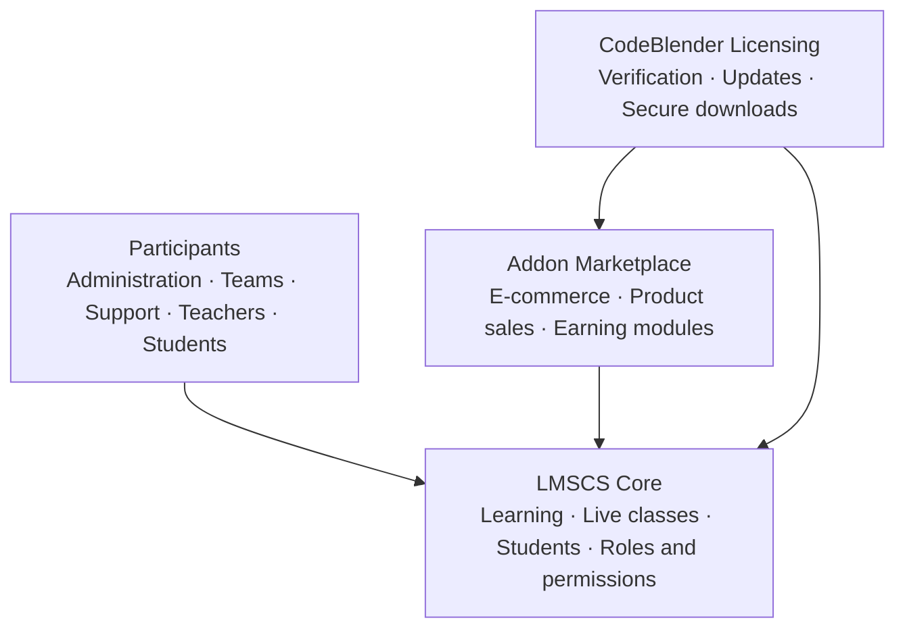

<h1>LMSCS</h1>

<h3>Learning Management System Complete Solution</h3>

by <strong>CodeBlender</strong>

One learning platform. Extend it with addons. Run it with the right people in the right roles.

  
  
  
  

  <a href="#platform">Platform</a> ·
  <a href="#capabilities">Capabilities</a> ·
  <a href="#addon-marketplace">Marketplace</a> ·
  <a href="#roles--access">Roles</a> ·
  <a href="#security">Security</a> ·
  <a href="#architecture">Architecture</a> ·
  <a href="#contact">Contact</a>

---

## Platform

**LMSCS** is a complete learning management system built by **CodeBlender**. It brings course delivery, live classes, student management and team operations into one place, with a role-based structure that fits how real learning businesses are organized.

It starts as a focused LMS and grows through an **Addon Marketplace**. New features arrive as addons that an administrator can install, update and switch on from the admin panel. Nothing has to be rebuilt to add a capability.

<table>
  <tr>
    <th align="center">Learn</th>
    <th align="center">Manage</th>
    <th align="center">Extend</th>
    <th align="center">Protect</th>
  </tr>
  <tr>
    <td align="center">Courses and live classes</td>
    <td align="center">Students, teams and roles</td>
    <td align="center">Addons on demand</td>
    <td align="center">Signed, verified updates</td>
  </tr>
</table>

## Capabilities

| Area | What it gives you |
| --- | --- |
| **Learning** | Course experiences for students and teachers, with live-class schedules and one-tap join links |
| **Student management** | Pending and active lists, approval, blocking, bulk assignment and detailed student records |
| **Teams** | Every student is connected to a Team Leader and a Trainer, with reassignment by authorized roles |
| **Referrals and earnings** | Student UID, referral links, earnings overview, wallet and withdrawal pages |
| **Consultation and ranking** | Consultation requests and ranking levels managed from the admin panel |
| **Admin panel** | One panel for people, roles, learning operations, updates, licensing and addons |
| **Responsive design** | One design system for admin, student and guest areas, in light and dark mode, on phone and desktop |

## Addon Marketplace

The core stays clean. Everything extra is an addon.

| Step | What happens |
| --- | --- |
| **Browse** | The admin panel lists every available addon in one marketplace page |
| **Install** | Free addons install in one click. Paid addons go through checkout and install after payment |
| **Update** | Addon updates are delivered and applied from the same page, with database migrations run automatically |
| **Control** | Enable, disable or remove an addon at any time |

**Selling courses is an addon.** Activate the E-commerce addon from the marketplace to sell courses. Product selling and further earning modules can be added the same way. Teams that do not need commerce simply never activate it.

## Roles & Access

LMSCS is designed for organizations where responsibility is shared. Access is controlled by roles and permissions, so each person sees and does only what their work needs.

| Group | Roles |
| --- | --- |
| **Administration** | Super Admin · Controller · Senior Manager |
| **Team operations** | Senior Team Leader · Team Leader |
| **Student support** | Senior Counsellor · Counsellor |
| **Teaching** | Teacher · Trainer |
| **Learners** | Student |
| **Custom** | Create your own roles with exactly the permissions you choose |

The exact permission set of each role is configured per deployment.

## Security

| Layer | Protection |
| --- | --- |
| **Licensing** | License checks are signed with HMAC-SHA256 and bound to the domain and hardware |
| **Updates** | Packages are integrity-checked with SHA-256 and scanned before installation, with a database backup first |
| **Downloads** | Download links are one-time and short-lived; source repositories stay private |
| **Access** | Role-based permissions with custom roles, plus token-based authentication |
| **Input** | HTML input is sanitized before it is stored or shown |

## Architecture

## Contact

- **Organization:** [LMSCompleteSolution](https://github.com/LMSCompleteSolution)
- **Product:** LMSCS, Learning Management System Complete Solution
- **Built by:** CodeBlender
- **Source code:** implementation repositories are private

For project questions, deployment details or partnerships, use the official contact channel published by the organization.

---

© LMSCS by CodeBlender. Features and availability depend on the installed version and activated addons.

