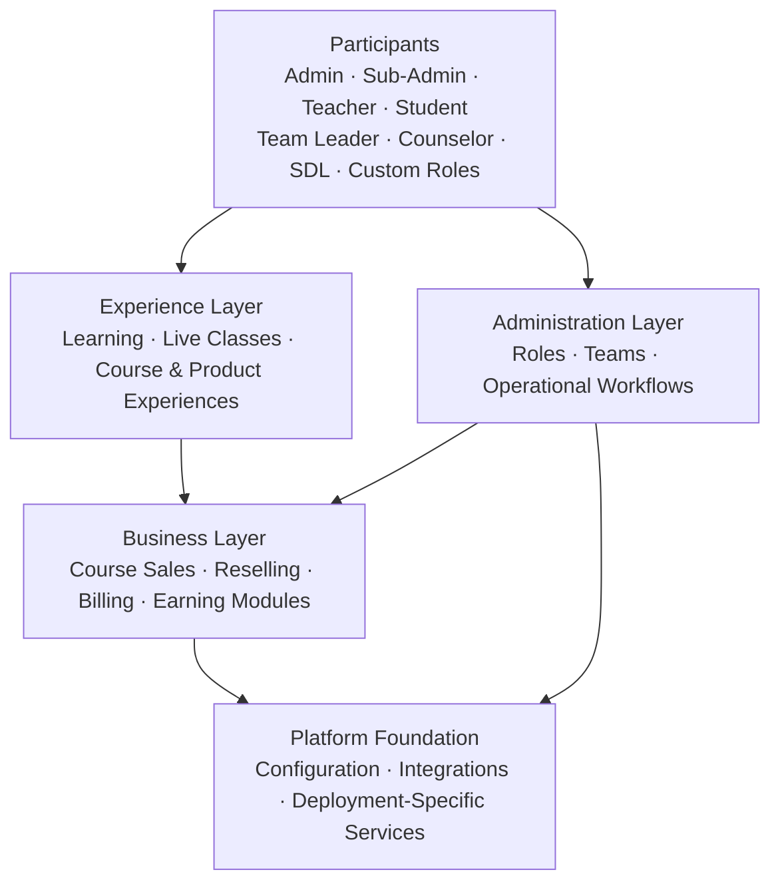

<div align="center">


<h1>LMSCS by CodeBlender</h1>

<h3>A Unified Engine for Learning, Commerce, Operations, and Growth</h3>

<p><strong>One platform. Multiple business models. Connected learning experiences.</strong></p>

<p>
  <a href="https://github.com/LMSCompleteSolution"></a>
  
  
  
</p>

<p>
  <a href="#-platform-overview">Platform</a> •
  <a href="#-core-capabilities">Capabilities</a> •
  <a href="#-roles--access-control">Roles &amp; Access</a> •
  <a href="#-commerce--monetization">Commerce</a> •
  <a href="#-platform-architecture">Architecture</a> •
  <a href="#-contact--organization">Contact</a>
</p>

</div>

---

## The Vision

**LMSCS — Learning Management System Complete Solution** is a comprehensive learning and business platform concept by **CodeBlender**, designed to bring education delivery, course commerce, team operations, and monetization into one connected environment.

Traditional learning platforms often focus on only one part of the journey: publishing lessons, managing students, or selling courses. LMSCS is designed around a broader idea: connect the entire learning business lifecycle — from administration and course delivery to live classes, product sales, reselling, role-based operations, and additional earning opportunities.

The goal is to give education businesses, training providers, course creators, and learning communities a unified foundation that can support different operating models without forcing every team into the same rigid workflow.

> **A complete learning business should not need a disconnected stack of tools to teach, sell, manage, collaborate, and grow.**

<div align="center">

<table>
  <tr>
    <th align="center">LEARN</th>
    <th align="center">MANAGE</th>
    <th align="center">SELL</th>
    <th align="center">SCALE</th>
  </tr>
  <tr>
    <td align="center">Courses and live learning</td>
    <td align="center">Teams and permissions</td>
    <td align="center">Courses and products</td>
    <td align="center">Flexible business workflows</td>
  </tr>
  <tr>
    <td align="center">Structured learning journeys</td>
    <td align="center">Role-aware operations</td>
    <td align="center">Reselling and billing</td>
    <td align="center">Extensible earning models</td>
  </tr>
</table>

</div>

## ✦ Platform Overview

LMSCS brings together the major components of a modern digital learning operation.

### One connected ecosystem

- **Learning delivery** — Organize course experiences for students and instructors.
- **Course commerce** — Support the business workflows around selling and reselling courses.
- **Live learning** — Bring real-time classes into the broader learning experience.
- **Product commerce** — Extend beyond courses with product-selling workflows.
- **Billing-oriented operations** — Connect financial and transaction workflows with platform administration.
- **Team management** — Structure work around administrators, educators, leaders, counselors, and other operational roles.
- **Flexible access control** — Support defined roles and the ability to create custom roles for different organizational needs.
- **Additional earning opportunities** — Make room for supplementary monetization modules and business-specific earning models.

The platform is intended to connect these capabilities through a common operational experience rather than treat them as isolated tools.

## ⚡ Core Capabilities

<table>
  <tr>
    <td width="50%" valign="top">
      <h3>🎓 Learning Management</h3>
      <p>Build a structured environment for course delivery, student participation, teaching activity, and the day-to-day administration of learning programs.</p>
      <ul>
        <li>Student and teacher-oriented workflows</li>
        <li>Course-focused learning experiences</li>
        <li>Centralized learning operations</li>
      </ul>
    </td>
    <td width="50%" valign="top">
      <h3>🛒 Course Commerce</h3>
      <p>Connect education with business operations so courses can be offered through commercial and reselling-oriented models.</p>
      <ul>
        <li>Course sales workflows</li>
        <li>Reselling-oriented business models</li>
        <li>Commerce integrated with learning operations</li>
      </ul>
    </td>
  </tr>
  <tr>
    <td width="50%" valign="top">
      <h3>🎥 Live Learning</h3>
      <p>Support live-class experiences as part of a broader digital learning environment, alongside course and student workflows.</p>
      <ul>
        <li>Live class workflows</li>
        <li>Teacher and student participation</li>
        <li>Learning experiences beyond static content</li>
      </ul>
    </td>
    <td width="50%" valign="top">
      <h3>💳 Billing &amp; Financial Operations</h3>
      <p>Bring billing-related workflows into the operational picture for a more connected learning business.</p>
      <ul>
        <li>Billing-oriented administration</li>
        <li>Business and transaction workflows</li>
        <li>Commerce-aware platform operations</li>
      </ul>
    </td>
  </tr>
  <tr>
    <td width="50%" valign="top">
      <h3>📦 Product Sales</h3>
      <p>Support business models that extend beyond digital courses and include the sale of products through the learning business ecosystem.</p>
      <ul>
        <li>Product-selling workflows</li>
        <li>Course and product business models</li>
        <li>Broader commercial flexibility</li>
      </ul>
    </td>
    <td width="50%" valign="top">
      <h3>🚀 Monetization Extensions</h3>
      <p>Make room for additional modules and earning opportunities that can complement a platform's primary learning and commerce activities.</p>
      <ul>
        <li>Supplementary earning models</li>
        <li>Business-specific extensions</li>
        <li>Growth-oriented platform design</li>
      </ul>
    </td>
  </tr>
</table>

## 🧩 A Platform for Different Business Models

LMSCS is designed for organizations whose learning operations may also involve sales, services, teams, and partner networks.

| Business model | How the platform can help |
| --- | --- |
| Online academies | Bring learning delivery and course-selling workflows into one environment. |
| Training organizations | Coordinate teachers, students, teams, and learning programs. |
| Independent educators | Organize course experiences and support commercial delivery. |
| Course resellers | Work with reselling-oriented course business models. |
| Education businesses | Combine learning, billing-related operations, and product sales. |
| Learning communities | Support multiple operational roles and different participation workflows. |
| Hybrid learning providers | Bring course-based and live-learning experiences into a shared platform concept. |

*These are intended use cases, not a guarantee that every workflow is enabled in every deployment.*

## 👥 Roles & Access Control

A learning business rarely operates through a single administrator account. LMSCS is designed around multiple types of participants, each with a different responsibility in the organization.

### Role ecosystem

| Role | Primary responsibility |
| --- | --- |
| **Admin** | Overall platform administration and high-level operational control. |
| **Sub-Admin** | Delegated administration for assigned areas of responsibility. |
| **Teacher** | Teaching activity and course-related responsibilities. |
| **Student** | Participation in learning experiences and student-facing workflows. |
| **Team Leader** | Team coordination and operational oversight. |
| **Counselor** | Counseling, guidance, and learner-support workflows. |
| **SDL** | A dedicated role within the platform's organizational workflow; its exact responsibilities can be defined by the deployment. |
| **Custom Roles** | Organization-specific roles for responsibilities that do not fit a fixed, predefined role. |

### Designed for structured delegation

A flexible role model helps organizations separate responsibilities instead of sharing one all-powerful account across the entire team. Custom-role support can make it easier to align platform access with an organization's structure.

A role system should always be configured according to the permissions each person actually needs. The exact permission matrix, approval rules, and role-specific screens depend on the implementation.

## 💼 Commerce & Monetization

Learning and commerce are closely connected for many education businesses. LMSCS is designed to support a wider operating model in which learning experiences and commercial workflows can work together.

### Commerce areas

- **Course sales:** Offer educational content through course-based business workflows.
- **Course reselling:** Support reselling-oriented approaches to course distribution.
- **Billing workflows:** Manage billing-related operations as part of the wider business process.
- **Product sales:** Extend the business model to products beyond courses.
- **Student earning opportunities:** Provide room for earning-related workflows associated with students, where enabled by the implementation.
- **Additional earning modules:** Make space for supplementary monetization opportunities and extensions.

### A connected business flow

```text
Learning Content
      │
      ▼
Course / Product Offering
      │
      ▼
Student or Customer Journey
      │
      ▼
Commerce & Billing Workflow
      │
      ▼
Platform Administration
      │
      ▼
Reporting, Team Operations & Growth
```

This is a conceptual view of the ecosystem, not a technical data-flow specification.

## 🎥 Learning Beyond Static Content

Live learning can add interaction and immediacy to a digital course experience. By placing live classes within the wider learning environment, LMSCS aims to support a more connected experience for educators and learners.

The intended model brings together:

- Structured course experiences
- Teacher and student participation
- Live-class workflows
- Supporting administration
- Commerce and operational processes around the learning business

Specific conferencing providers, recording behavior, attendance logic, scheduling rules, and integrations should be documented once confirmed for the deployed version.

## 🛡 Administration, Governance & Operational Clarity

A growing learning operation needs more than content delivery. It also needs a clear way to organize people, responsibilities, and business processes.

LMSCS is designed with the following operational principles in mind:

- **Centralized oversight:** Keep core administration connected to the overall platform.
- **Delegated responsibility:** Use sub-administrative and team-oriented roles where appropriate.
- **Role-aware workflows:** Align responsibilities with the type of work each participant performs.
- **Flexible organizational structure:** Accommodate custom roles when standard roles are not enough.
- **Connected operations:** Bring learning, commerce, and administration into a coherent ecosystem.
- **Extensible business models:** Leave room for additional modules and earning-related workflows.

These are design goals and capability areas. Specific security controls, audit trails, compliance standards, and permission enforcement should be verified against the actual implementation.

## 🧱 Platform Architecture

At a high level, LMSCS can be understood as a set of connected functional layers. This diagram describes the product concept rather than asserting a particular programming language, framework, database, or deployment topology.



### Architectural principles

| Principle | Intended outcome |
| --- | --- |
| **Unified experience** | Reduce unnecessary separation between learning and business workflows. |
| **Role-aware operations** | Make responsibilities clearer across different participant types. |
| **Modular capability areas** | Organize the platform around learning, commerce, administration, and extensions. |
| **Business-model flexibility** | Accommodate different education and commerce workflows. |
| **Deployment-aware implementation** | Document technical details according to the actual version and environment. |

## 🔄 Example End-to-End Workflow

The following illustrates one possible journey through a learning business using the platform's intended capability areas.

1. **Configure the organization** — Establish administrative responsibilities and the relevant role structure.
2. **Prepare learning offerings** — Organize courses and the associated learning experience.
3. **Enable delivery** — Make course and live-learning workflows available to the relevant participants.
4. **Connect commerce** — Configure the applicable course-sales, reselling, product-sales, or billing workflows.
5. **Coordinate the team** — Assign work to teachers, team leaders, counselors, sub-admins, and other appropriate roles.
6. **Extend the model** — Introduce supported earning-related modules and organization-specific workflows.
7. **Review and improve** — Refine the operational model as the organization grows.

*Actual screens, automation, approval steps, and transaction behavior depend on the deployed implementation.*

## 🌐 Designed for an Evolving Learning Ecosystem

LMSCS is positioned as more than a basic course catalogue. Its broader direction is to connect the operational pieces around a learning business: people, learning experiences, commerce, administration, and growth.

The platform's capability areas are intended to support organizations as they evolve from a simple course operation toward a more structured learning business.

### What makes the concept distinctive?

- A learning-first foundation with business workflows in view
- Course commerce and reselling as part of the wider ecosystem
- Live learning alongside course-based experiences
- Product-selling and supplementary monetization possibilities
- Multiple organizational roles, including custom roles
- A unified direction for learning, administration, and growth

## 🧭 Product Scope & Transparency

This organization page introduces LMSCS and its intended capability areas. It is not a substitute for version-specific documentation.

To keep product information trustworthy:

- Capabilities described here should be verified against the relevant deployment before being represented as generally available.
- Integrations and third-party services should be listed only after they are confirmed.
- Security, privacy, performance, compliance, and availability claims should be supported by implementation details or published policies.
- Technical stack, APIs, installation instructions, and system requirements should be documented in the relevant project documentation when available.
- Private repositories may contain implementation details that are not publicly disclosed on this page.

## 🧑‍💻 About CodeBlender

**CodeBlender** is the product organization behind LMSCS. The LMSCS initiative focuses on connecting learning management with the operational and commercial needs of modern education businesses.

<div align="center">

<a href="https://github.com/LMSCompleteSolution"></a>

<br>

<strong>Learning infrastructure, connected business workflows, and room to grow.</strong>

</div>

## 🔐 Repository Visibility & Project Access

The organization's implementation repositories may remain private. This public profile README serves as an introduction to LMSCS; it does not require source-code repositories to be made public.

Access to source code, internal documentation, and deployment resources is governed by the organization's repository permissions.

## 📬 Contact & Organization

- **Organization:** [LMSCompleteSolution](https://github.com/LMSCompleteSolution)
- **Product:** LMSCS — Learning Management System Complete Solution
- **Product organization:** CodeBlender
- **Primary focus:** Learning management, course commerce, live learning, role-based operations, and monetization workflows

For project-specific information, deployment details, integration questions, or collaboration inquiries, use the official contact channel published by the organization.

---

<div align="center">

<h3>One Learning Platform. A Broader Business Possibility.</h3>

<sub>© LMSCS by CodeBlender. Product scope and availability may vary by implementation.</sub>

</div>
